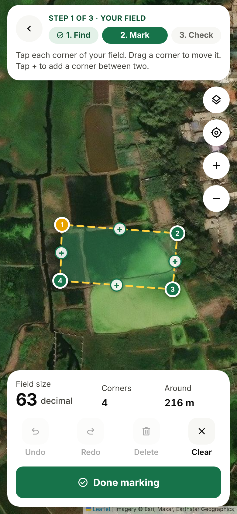
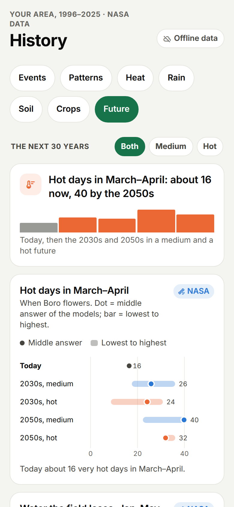
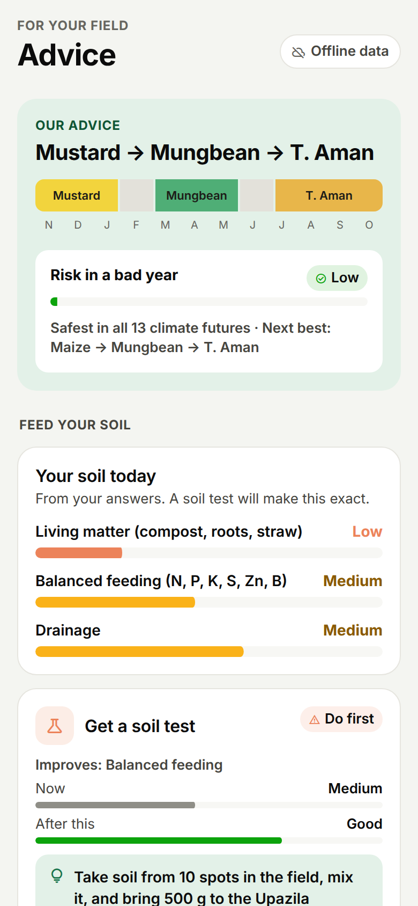
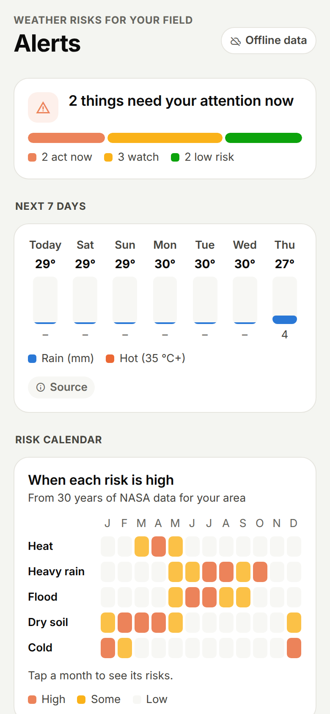

# Furrow

**Which crop rotation should this field follow for the next few years, given how its climate has already changed and how it is likely to change next?**

Furrow is a mobile decision-support app for one farmer and one field. It combines three NASA datasets with the field's soil, the characteristics of each crop and the farmer's own priorities. Then it compares crop rotations on climate stress, water demand, soil health and income, and recommends the rotation that stays close to the best choice in every climate future we test, not the one that wins in only one of them.

| | |
|---|---|
| **Event** | NASA International Space Apps Challenge 2026 |
| **Challenge** | Field Shift: Adapting Farms with NASA Data |
| **Pilot field** | Ashulia, Savar, Dhaka, Bangladesh (23.9° N, 90.3° E, rounded to 0.1°) |
| **Demo (30 s video / ≤ 7 slides)** | _link added at submission_ |
| **Android app (APK)** | [Furrow v1.0.0 release](https://github.com/Ratul-islam/Furrow/releases/latest) |
| **Try it in a browser** | [ratul-islam.github.io/Furrow](https://ratul-islam.github.io/Furrow/) (best at phone width) |
| **Space Apps project page** | _link added at submission_ |
| **Licence** | [Apache 2.0](LICENSE) |

> **Decision support, not a forecast.** Every projection is shown as a range, with the scenario named. Parts that use demo data carry a "Demo" badge in the app.

<table>
  <tr>
    <td align="center"><br><sub>1. Mark the field</sub></td>
    <td align="center"><br><sub>2. What shifts next</sub></td>
    <td align="center"><br><sub>3. Lowest-regret rotation</sub></td>
    <td align="center"><br><sub>4. Warnings and actions</sub></td>
  </tr>
</table>

All 41 screens, full length, are in [`screenshots/`](screenshots/).

---

## Summary

Farmers around Ashulia mostly grow Boro rice in the dry season and Aman rice in the monsoon, with the land empty in between. Boro needs a great deal of pumped groundwater, and it flowers in March–April, which is the hottest part of the year. NASA POWER shows about 16 days at or above 35 °C in March–April at this location today. The NEX-GDDP-CMIP6 futures we tested put that at roughly 24 to 40 days by the 2030s and 2050s. Rice flowering is sensitive to heat above about 35 °C.

Furrow takes a farmer from "where is my field" to "which rotation should I follow, and what do I do this season" in a few minutes. The farmer marks the field on a satellite map and answers 18 short questions about crops, land, water, soil and priorities. Furrow then scores five candidate rotations, including the farmer's current one, against 13 climate futures: the observed 2001–2025 climate plus 12 model futures (three CMIP6 models × SSP2-4.5 and SSP5-8.5 × 2030s and 2050s). It recommends the rotation with the smallest worst-case regret. With equal priorities that is **Mustard → Mungbean → T. Aman**. In the observed climate it needs about 530 mm of irrigation a year, against about 1,210 mm for the current Boro – Fallow – T. Aman. It also puts a nitrogen-fixing legume into the rotation and gives the hottest months to mungbean, which tolerates more heat than Boro. The runner-up is Maize → Mungbean → T. Aman. If the farmer changes their priorities, the ranking changes with them.

## How Furrow answers the challenge

| The challenge asks for | What Furrow does |
|---|---|
| A decision-support tool | One decision for one field: which rotation to follow for the next few years, plus the jobs for this season |
| NASA Earth observations | POWER (weather, rain, soil wetness, 1996–2026), MODIS MOD13Q1 (crop greenness, 2000–2026), NEX-GDDP-CMIP6 (climate futures). See [NASA data](#use-of-nasa-data) |
| Local soil information | Soil type, soil-test status, fertiliser use, straw and cattle questions in onboarding; soil-nutrient advice follows BARC's *Fertilizer Recommendation Guide 2018*. The soil profile for the pilot field is typical values, labelled Demo |
| Crop characteristics | A table of 13 crops: season, FAO-56 crop coefficients, heat limit, sensitive stage, legume or not, family. Every row names its source |
| Farmer priorities | The farmer weights *safe from bad weather*, *save water*, *healthy soil* and *more money*. The weights change the ranking |
| Explore rotation strategies | Five rotations side by side, including the farmer's current one as the baseline; rotations the farmer cannot grow on their land are flagged |
| Strengthen soil health | A soil-health score for each rotation: months with the soil covered, legume in the rotation, number of crop families, a penalty for rice after rice |
| Adapt to changing conditions | Every rotation is scored in 12 projected futures as well as the observed climate |

## What the farmer sees

1. **Onboarding.** Find the village, tap the field's corners on a satellite map (area shown in decimals and bigha), and answer 18 questions with pictures and short options.
2. **Home.** Field status, crop health from satellite (MODIS greenness against the 2001–2025 normal), top warnings, jobs to do now, next year's advice, recent rain and soil moisture.
3. **Alerts.** Flood, heavy rain, heat, drought, cold, dry-spell, waterlogging and pest warnings, each with what to do. Built from 30 years of NASA data, the farmer's answers and a live 7-day forecast (Open-Meteo, labelled as not NASA). Includes a 12-month risk calendar.
4. **Advice.** The recommended rotation and the runner-up, risk in a bad year, a soil-nutrient plan, all rotations compared on water, stress days, soil and income, and the season's to-do list.
5. **History.** The area's big events (wettest monsoons, driest winters, hottest springs), heat, rain, soil moisture, crop health, and the future climate as ranges across models.
6. **Drone.** Request a drone check of the field and read the survey report. **This tab runs on simulated data**, scaled to the real MODIS greenness curve and labelled Demo.
7. **Data and methods.** Every source, with its licence and how we use it.

## How the recommendation is made

All of this is in [`analysis/build_dataset.py`](analysis/build_dataset.py) (data) and [`mobile/src/lib/engine.ts`](mobile/src/lib/engine.ts) (scoring).

1. **History.** NASA POWER daily data, 1996 to October 2026, for the field's location. We count heat days (≥ 35 °C and ≥ 38 °C), cold nights (< 15 °C), heavy-rain days (≥ 50 mm) and dry spells per month and year, and compute reference evapotranspiration with the FAO-56 Hargreaves equation.
2. **Futures.** For each CMIP6 model, scenario and horizon, we take the seasonal change in daily maximum temperature and in rainfall against that model's own historical years. Then we apply the change to the observed 2001–2025 days (the delta method). That gives 12 futures. Together with the observed climate, there are 13.
3. **Scores.** In each future, each rotation gets four scores from 0 to 100:
   - *Climate:* expected heat, cold and waterlogging days during each crop's sensitive stage.
   - *Water:* irrigation need = crop coefficient × reference evapotranspiration − effective rain, plus percolation for paddy (FAO-56). Alternate wetting and drying (AWD) saves about 25%.
   - *Soil:* the rule-based score described above.
   - *Income:* illustrative net income after irrigation cost and stress losses. **Crop prices are example values.**
4. **Priorities.** The farmer's weights combine the four scores into one number per rotation per future.
5. **Regret.** In each future, a rotation's regret is how far it falls short of the best rotation in that future. Furrow recommends the rotation whose worst regret is smallest, and shows the runner-up and why.

Here is a worked example with made-up numbers (higher score is better; these are not results):

| Rotation | Score, future 1 | Score, future 2 | Regret, future 1 | Regret, future 2 | Worst regret |
|---|---|---|---|---|---|
| A | 80 | 50 | 0 | 15 | 15 |
| **B** | 70 | 65 | 10 | 0 | **10** |
| C | 60 | 62 | 20 | 3 | 20 |

Rotation A is the best in one future and poor in the other. Rotation B is never far behind the best, so it is the lowest-regret choice. The app does the same thing across all 13 futures.

**Rotations compared:** Boro – Fallow – T. Aman (current practice) · Boro with AWD – Fallow – T. Aman · Mustard – Late Boro – T. Aman · Mustard – Mungbean – T. Aman · Maize – Mungbean – T. Aman.

**Other predictions in the app**, each shown with its method and range: hot days in March–April 2027, the best Boro transplant window for 2026–27 (fewest expected heat and cold days at flowering), and the condition of this year's Aman crop from MODIS greenness.

## What is real and what is demo

| In the app | Data | Status |
|---|---|---|
| 30 years of heat, rain and soil wetness | NASA POWER daily | **Real** |
| Crop greenness since 2000, this season against normal | MODIS MOD13Q1 v061 | **Real** |
| Climate futures, 2030s and 2050s, two scenarios | NEX-GDDP-CMIP6, 3 models, sampled years | **Real**, small sample |
| Predictions (heat days 2027, Boro window, Aman condition) | Computed from the data above | **Real data, simple methods** |
| Rotation scores and recommendation | FAO-56 water + crop table + rules + minimax regret | **Real logic**; crop prices illustrative |
| 7-day forecast | Open-Meteo (not NASA), fetched live | **Real** |
| Drone canopy maps, problem zones | Simulated from the MODIS curve | **Demo**, labelled |
| Soil profile of the pilot field | Typical values | **Demo**, labelled |

## What we checked, and what we do not claim

**Data problems we found and handle in the app**
- At this location POWER's daily maximum temperature runs 2–4 °C warmer than NEX-GDDP-CMIP6 (which is bias-corrected to observations) in March–May. We adjust it month by month, and the offsets ship with the data.
- POWER rainfall and soil wetness jump in 2017, from about 1,670 to 2,670 mm of rain a year. That looks like a change in the data source, not the climate. We fit trends to 1996–2016 only and mark the break on every long-record chart. We have not confirmed the cause; GPM IMERG would settle it.

**Limits**
- The CMIP6 sample is small: three models (ACCESS-CM2, MIROC6, MRI-ESM2-0) and one or two sampled years per period, not full 30-year windows. MIROC6 and MRI-ESM2-0 are incomplete for some variables. The ranges in the app are therefore narrower and noisier than a full ensemble would give. For example, the 2050s high-emissions bar can sit below the medium one.
- We have not yet backtested the stress score against MODIS greenness anomalies or local yields. Until we do, the climate score rests on published crop thresholds (heat ~35 °C at rice flowering, cold < 15 °C), which an agronomist still has to confirm for this area.
- The soil-health score is a rule-based indicator built from published agronomy. It is not a measurement, and 25 years of satellite data cannot test it.
- Crop prices are examples. Furrow does not predict yields or prices.
- The app is in English only for now.

## Can a model trained on NASA data predict better?

We tested this before deciding how the app makes its predictions. For each target, a small regression model was trained on NASA data with one year left out, then asked to predict that year; this was repeated for every year. Its average error is compared with two simple guesses: the average of the other years ("normal year") and a straight-line trend.

| Target | Predictors (NASA data) | Years | Model error | Normal-year error | Trend error | Skill vs normal year |
|---|---|---|---|---|---|---|
| Aman peak greenness (MODIS NDVI) | Jul–Sep Tmax, heat days, rain, root-zone soil wetness (POWER) | 25 | 0.031 | 0.030 | 0.030 | 0% |
| Boro peak greenness (MODIS NDVI) | Dec–Jan cold days, Feb–Mar heat days, Jan–Mar Tmax, Dec–Mar rain (POWER) | 25 | 0.056 | 0.048 | 0.051 | −16% |
| Boro peak greenness | January greenness so far (MODIS) | 25 | 0.048 | 0.048 | 0.051 | +1% |
| Aman peak greenness | Jul–Aug greenness so far (MODIS) | 5 | 0.008 | 0.017 | 0.020 | +50%, but only 5 cloud-free years |
| Hot days (≥ 35 °C) in Mar–Apr | Jan–Feb Tmax and rain, February heat days (POWER) | 29 | 10.1 days | 8.8 days | 9.6 days | −15% |

**Result: no model beat "assume a normal year"**, so the app does not use one. Its predictions use the simpler method instead: 25 years of history, shifted by the CMIP6 change, shown as a range. Likely reasons:

- **Very little data.** There are about 25 seasons from one 250 m MODIS pixel and one POWER grid cell.
- **Farming moves greenness more than weather does.** Aman greenness barely changes from year to year (0.77 ± 0.03); variety, fertiliser and transplant date matter more.
- **Monsoon clouds** remove most mid-season MODIS readings.
- **History has little forward signal.** January weather says almost nothing about April heat. Seasonal skill comes from ocean patterns such as El Niño, which are not in these datasets.

We did not use a large language model for predictions either. It would produce numbers we could not test this way. To reproduce the table (standard library only): `python3 ml/baseline_test.py`.

## Future development

**Next, after the event**
- **Fuller climate futures.** All available NEX-GDDP-CMIP6 models, full 30-year windows (2021–2050, 2041–2070) and quantile mapping against local history, instead of three models and sampled years.
- **More NASA data.** SMAP L4 soil moisture (`SPL4SMGP`) for field-scale soil water, and GPM IMERG rainfall to resolve the 2017 break in POWER rainfall.
- **Backtest the stress score.** Compare it with MODIS greenness anomalies and district yields for 2001–2025, and publish the misses as well as the hits.
- **A real soil profile.** Replace the demo values with the farmer's soil test and SoilGrids (250 m).
- **Agronomy review.** An extension officer from the Department of Agricultural Extension checks the crop thresholds, the rotations and the advice text.

**Next 3–6 months**
- **Bangla.** The whole app in Bangla, with voice for farmers who prefer listening. Advice text can be drafted by a language model from the computed results only, checked automatically so it adds no numbers, with a fixed template as fallback, and reviewed by a native speaker.
- **A prediction model with enough data.** Repeat the test above on MODIS pixels across many upazilas and several POWER cells, which gives thousands of samples instead of 25. It ships only if it beats the normal-year baseline.
- **Real drone surveys.** Turn our own drone images into canopy-cover maps on a 5 m grid and compare them with MODIS, replacing the simulated flights.
- **Local prices.** Use open market prices from the Department of Agricultural Marketing so the income score is not illustrative.
- **Field sensors.** A low-cost soil-moisture and rain node, compared with SMAP and IMERG (reported as agreement or bias, not validation).

**Later**
- **More regions.** Every NASA dataset used here is global, so a new region needs a crop table, its rotations and a local review, not new data infrastructure. First other parts of Bangladesh, then other rice systems in South Asia.
- **Pilot with farmers.** A season-long pilot with an extension office: did farmers change their rotation, and what happened to water use and yields?

## Use of NASA data

All three datasets are pulled ahead of time by scripts in [`pipelines/`](pipelines/) and bundled into the app. The app needs no NASA login and makes no live NASA calls. Every API, request, licence and citation is listed in [docs/SOURCES.md](docs/SOURCES.md).

| Used for | Dataset | Access | Citation |
|---|---|---|---|
| Daily weather, rain and soil-water history, 1996–2026: heat and cold days, dry spells, heavy rain, crop water need, alerts, Boro window | **NASA POWER** daily point API (`T2M`, `T2M_MAX`, `T2M_MIN`, `PRECTOTCORR`, `RH2M`, `ALLSKY_SFC_SW_DWN`, `GWETTOP`, `GWETROOT`, `WS2M`), community `ag` | [power.larc.nasa.gov](https://power.larc.nasa.gov), no key | NASA Langley Research Center POWER Project |
| Crop greenness, 2000–2026: crop health now against normal, season peaks, Aman condition, weather-versus-crop patterns | **MODIS MOD13Q1 v061** NDVI, 250 m, 16-day, with pixel reliability | ORNL DAAC MODIS/VIIRS Land Product Subsets API, no key | Didan, K. (2021), NASA LP DAAC, DOI [10.5067/MODIS/MOD13Q1.061](https://doi.org/10.5067/MODIS/MOD13Q1.061) |
| Climate futures, 2030s and 2050s, SSP2-4.5 and SSP5-8.5: the 12 futures every rotation is scored in | **NEX-GDDP-CMIP6**, 0.25°, daily `tasmax` and `pr` | AWS Open Data `s3://nex-gddp-cmip6`, CC0 | Thrasher et al. (2022), *Scientific Data* 9, 262, DOI [10.1038/s41597-022-01393-4](https://doi.org/10.1038/s41597-022-01393-4); dataset DOI [10.7917/OFSG3345](https://doi.org/10.7917/OFSG3345) |

*These data were obtained from the NASA Langley Research Center (LaRC) POWER Project funded through the NASA Earth Science/Applied Science Program.*

**Next NASA data**, once the team has Earthdata logins set up: SMAP L4 soil moisture (`SPL4SMGP`, DOI [10.5067/T5RUATAQREF8](https://doi.org/10.5067/T5RUATAQREF8)) for field-scale soil water, and GPM IMERG (`GPM_3IMERGDF` v07) to check the 2017 break in POWER rainfall.

## Space agency partner data

None used in this version.

## Other data, tools and references

| What | Source | Licence / terms |
|---|---|---|
| 7-day forecast (alerts only) | [Open-Meteo](https://open-meteo.com) forecast API | CC BY 4.0, free for non-commercial use |
| Place search | OpenStreetMap Nominatim | ODbL; usage policy followed (search on button press only, ≤ 1 request/s) |
| Map tiles | Esri World Imagery; OpenStreetMap | Attribution shown on the map |
| Crop water need, crop coefficients | Allen et al. (1998), *FAO Irrigation and Drainage Paper 56* | Published method |
| Rice heat sterility at flowering above ~35 °C | Jagadish et al. (2008) | Published study |
| Soil and fertiliser advice | BARC (2018), *Fertilizer Recommendation Guide* | Published guide |
| AWD water saving, flood-tolerant Aman varieties | IRRI / BRRI guidance | Published guidance |
| App | Expo SDK 58, React Native 0.88, React 19, Expo Router, react-native-svg, d3-scale/d3-shape, Leaflet 1.9 | MIT / BSD |
| Backend (optional) | Supabase (Postgres with row-level security) | Apache 2.0 client |
| Data pipeline | Python 3 standard library, `h5py`, `numpy` | BSD |

**Languages:** TypeScript (app), Python (pipelines), SQL (database). **Hardware:** none in this version; the drone tab is a demo.

## Use of AI

- **Code and documentation.** The team used Claude Code (Anthropic) as a coding assistant to draft parts of the app, the data scripts, the database schema and this documentation. Team members directed the work, reviewed and ran the code, and checked the results against the source data.
- **Inside the app.** Furrow contains no AI or machine-learning model. We tested regression models trained on NASA data, and none beat the normal-year baseline (see [Can a model trained on NASA data predict better?](#can-a-model-trained-on-nasa-data-predict-better)). Every number comes from NASA data, published methods and the rules in [`mobile/src/lib/engine.ts`](mobile/src/lib/engine.ts) and [`mobile/src/lib/advisor.ts`](mobile/src/lib/advisor.ts).
- **Media.** The screenshots are real captures of the app. No AI-generated images, video or voice are used in the repository. If any appear in the demo video or slides, they are labelled "AI-generated" on screen.

## Install the demo

- **Android:** download `Furrow-v1.0.0.apk` from the [latest release](https://github.com/Ratul-islam/Furrow/releases/latest), open it on the phone and allow installing from this source. It needs Android 7 or later on a 64-bit (arm64) phone, which covers nearly all phones from recent years. The app runs on the NASA data bundled inside it, so it works offline. Only the 7-day forecast, place search and map tiles need a connection.
- **Web:** open [ratul-islam.github.io/Furrow](https://ratul-islam.github.io/Furrow/), or download `Furrow-web-v1.0.0.zip` on the same release is a static build. Unzip it and serve the folder with any static server, for example `npx serve -s furrow-web`.
- **iPhone:** use the web version, or run the app from source with Expo Go (below).

## Run it

Requires Node.js 20+ and npm. No account or key is needed; the app runs on the bundled NASA data.

```bash
cd mobile
npm install
npx expo start        # press w for the web version, or scan the QR code with Expo Go
```

Checks: `npm run typecheck` and `npm run lint` (in `mobile/`).

**Rebuild the data from NASA** (no NASA login needed; Python 3.10+):

```bash
python3 pipelines/fetch_nasa.py                              # POWER + MODIS → data/raw/
pip install h5py numpy && python3 pipelines/fetch_cmip6.py   # CMIP6 point series (downloads and deletes ~250 MB files)
python3 analysis/build_dataset.py                            # → data/derived/, mobile/src/data/, supabase/seed.sql
```

**Supabase (optional).** Create a project, run the files in [`supabase/migrations/`](supabase/migrations/) and then [`supabase/seed.sql`](supabase/seed.sql), and put the project URL and anon key in `mobile/.env` (see `mobile/.env.example`). Data tables are public read-only. Farm profiles and drone requests are insert-only for the app, and only the service role can read them back. Without Supabase, the app uses the bundled copy and shows "Offline data".

## Repository layout

```
mobile/            Expo app (iOS, Android, web): the main deliverable
  src/lib/engine.ts    rotation scoring: FAO-56 water, stress days, soil rules, minimax regret
  src/lib/advisor.ts   farmer answers → current rotation, priorities, constraints, soil tips
  src/lib/alerts.ts    warnings from NASA history + answers + 7-day forecast
  src/data/            bundled data (generated; do not edit by hand)
pipelines/         scripts that pull NASA POWER, MODIS and NEX-GDDP-CMIP6
analysis/          build_dataset.py: tables, futures, predictions, app bundle, seed SQL
ml/                baseline_test.py: can a model beat a normal year? (leave-one-year-out)
data/derived/      small derived tables (committed); data/raw/ is rebuilt by pipelines and not committed
supabase/          database schema and generated seed
docs/SOURCES.md    every data source, request, licence and citation
screenshots/       every screen of the app
```

## Privacy and safety

- The pilot field's location is rounded to 0.1°. No farmer names, phone numbers or field outlines are in this repository.
- A farm profile and drone request (which can include a phone number) are saved only on the phone and, if Supabase is configured, in insert-only tables that the app cannot read back.
- No images of people appear in the repository, the app or the demo.

## Team

_Team name and members' Space Apps handles added at submission._

## Licence

Apache License 2.0. See [LICENSE](LICENSE). NASA data are used under their open-data terms; NEX-GDDP-CMIP6 is CC0. Third-party data keep their own licences, listed above. Furrow is not endorsed by NASA.
